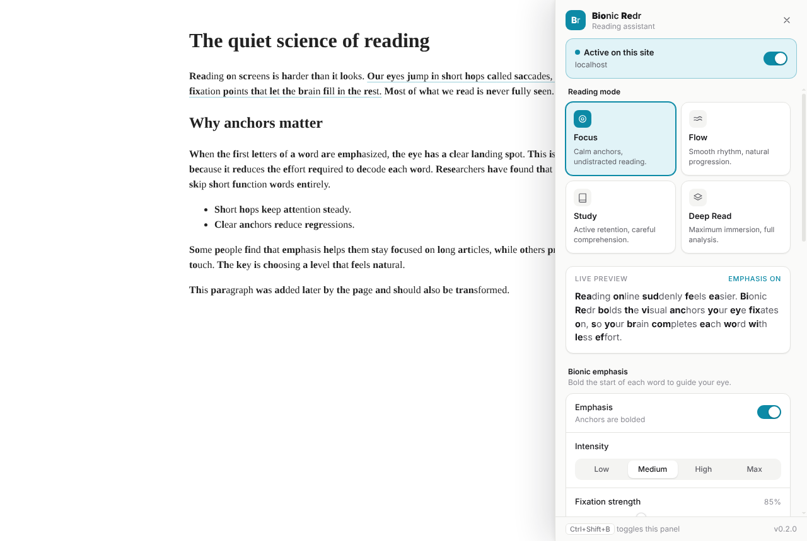
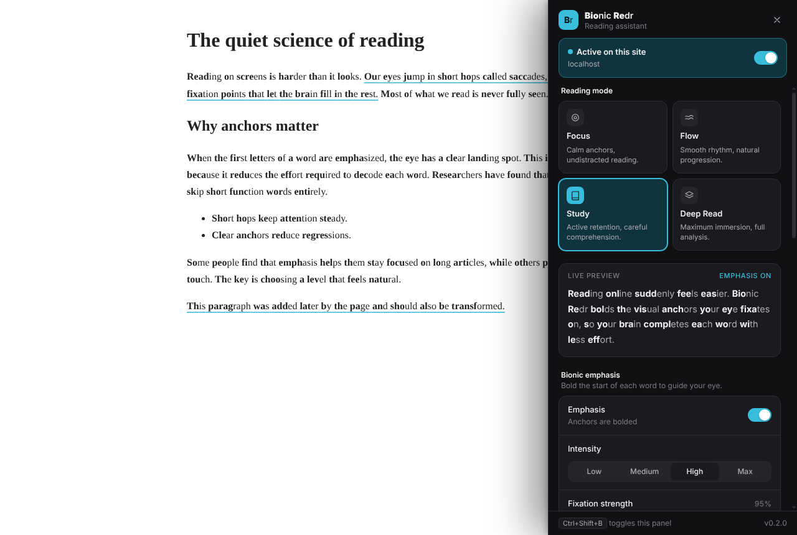

<p align="center">
  
</p>

<h1 align="center">Bionic Redr</h1>

<p align="center">
  Read the web faster and with less effort.<br>
  A Chrome extension that bolds the start of each word to guide your eye, then adds focus aids, comfortable typography and reading memory.
</p>

<p align="center">
  <a href="https://github.com/htoomyatk645/Bionic-readr-/actions/workflows/ci.yml"></a>
  
  
  <a href="LICENSE"></a>
</p>

<p align="center">
  
  
</p>

## Features

- **Bionic emphasis.** Bolds the first letters of every word so your eye has a clear landing spot. Four intensities plus a fine-grained fixation slider.
- **Reading modes.** Focus, Flow, Study and Deep Read presets. Tweak any mode and it remembers your changes.
- **Focus aids.** Sentence radar underlines the most important sentences. Skim layers dim everything except key points, or show only headlines.
- **Typography.** Adjust line height, letter spacing and paragraph spacing on any page.
- **Adaptive.** Learns your reading rhythm on your device and gently eases dense passages.
- **Continuity.** Remembers where you stopped on each page and offers to resume.
- **Per-site control.** Pause it on any site with one switch.
- **Light and dark.** The panel follows your system theme, or you can choose one.

Open the panel with the toolbar icon or <kbd>Ctrl</kbd>+<kbd>Shift</kbd>+<kbd>B</kbd> (<kbd>⌘</kbd>+<kbd>Shift</kbd>+<kbd>B</kbd> on Mac).

## Privacy

Everything stays on your device. Bionic Redr has no servers, no analytics and no tracking. Settings, reading positions and the adaptive profile live in Chrome's local extension storage, and you can clear your reading history from the panel. See [PRIVACY.md](PRIVACY.md).

## Install

### From source (developer mode)

You need [Node.js](https://nodejs.org) 18 or newer.

```bash
git clone https://github.com/htoomyatk645/Bionic-readr-.git
```

```bash
cd Bionic-readr-
```

```bash
npm install
```

```bash
npm run build
```

> On Windows PowerShell 5.1, run each command on its own line (`&&` isn't supported there).

1. Open `chrome://extensions` in Chrome.
2. Turn on **Developer mode** (top right).
3. Click **Load unpacked** and select the `build/` folder.
4. Pin Bionic Redr from the puzzle-piece menu and open any article.

To update later, run `git pull` and then `npm run build`, then click the reload icon on the Bionic Redr card in `chrome://extensions`.

### Publishing to the Chrome Web Store

See [docs/PUBLISHING.md](docs/PUBLISHING.md) for the full step-by-step guide.

## Development

```bash
npm run dev        # rebuild on every save
```

```bash
npm run typecheck  # TypeScript checks
```

```bash
npm run package    # build and zip into release/ for the Web Store
```

After a rebuild, reload the extension in `chrome://extensions` and refresh the page you're testing.

### Project structure

```
src/
  background.ts        Service worker: toolbar click, shortcut, storage writes
  contents/
    bionic.ts          Page engine: transforms text, applies modes and aids
    sidebar.tsx        Mounts the settings panel in a shadow root
    warmup.tsx         "Welcome back" resume hint
  core/                Bionic engine, DOM walking, semantics, behavior and learning models
  features/            Settings store, mode presets, radar, skim, reading memory
  ui/                  Panel components (React + Tailwind)
icons/                 Extension icons (icon.svg is the source)
scripts/               esbuild build and packaging scripts
```

Built with TypeScript, React, Tailwind CSS, Zustand and esbuild.

## Contributing

Issues and pull requests are welcome. Please run `npm run typecheck` and `npm run build` before opening a pull request.

## License

[MIT](LICENSE)
